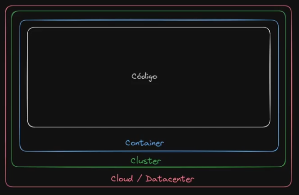
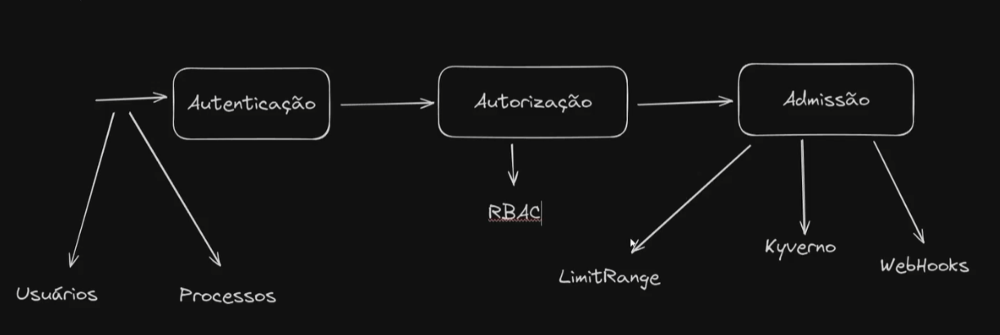

# Introdução

Trabalharemos com os 4 Cs de segurança da Cloud Native 

1 - Cloud/Datacenter - Nesta camada é relacionado sobre as práticas de segurança de recursos.

2 - Cluster - Segurança encima do kubernetes, em clustes gerenciados o gerenciamento é compartilhado com o cloud provider como AWS e afins, agora em um cluster gerenciado localmente terá mais responsábilidades para gerenciar.

3 - Container - Relacionado a segurança da construção do container e ferramentas para garantir essa segurança.

4 - Código - Aqui entra a parte em quais itens eu posso usar para garantir a segurança na aplicação, exemplo nao colocar senhas em Hardcoded. 



Nós tópicos abaixo será abordado sobre segurança no nivel do Cluster.


## Security Context

No Docker , podemos definir o usuário e grupo que o container vai rodar, no Kubernetes isso é feito através do Security Context.

Muitas vezes, por padrão, o container roda como root, e isso é um risco de segurança, pois se alguém conseguir invadir o container, ele terá acesso a todo o sistema.

Com o Security Context, podemos definir o usuário e grupo que o container vai rodar, e também podemos definir se ele pode ou não rodar como root.

Podemos definir usuario, permissões, capacidades, entre outros.

###  Definiçao de usuario e grupo.

Exemplo de definição de usuário e grupo no Security Context:

No exemplo abaixo podemos ver que é possivel definir o securityContext no nível do Pod e no nível do Container, e que o securityContext do container sobrescreve o securityContext do pod.

Um cuidado importante é que se definir um usuario diferente do que a aplicação foi desenvolvida, pode ser que a aplicação não funcione corretamente, pois ela pode não ter permissão para acessar arquivos e diretórios.

```yaml
apiVersion: v1
kind: Pod
metadata:
  name: security-context-demo
spec:
  securityContext: # Definição de segurança do pod
    runAsNonRoot: true # Não permite que o container rode como root
    runAsUser: 1000 # ID do usuário que o container vai rodar
    runAsGroup: 3000 # ID do grupo que o container vai rodar
    containers:
    - name: sec-ctx-demo
      image: busybox
      command: ["sh", "-c", "sleep 1h"]
      securityContext: # Definição de segurança do container, sobrecreve o securityContext do pod
        allowPrivilegeEscalation: false # Não permite que o container eleve seus privilégios
```

### Tratando Volumes e Filesystem

No exemplo abaixo vamos definir o securityContext para volumes e filesystem.

O `fsGroup` é definido a nivel do Pod, e ele define o grupo que terá acesso aos volumes montados, e também define a permissão de leitura e escrita para os arquivos criados dentro do volume.

```yaml
apiVersion: v1
kind: Pod
metadata:
  name: security-context-demo
spec:
    securityContext:
        fsGroup: 2000 # Define o grupo que terá acesso aos volumes montados
        runAsUser: 1000
        runAsGroup: 1000
        containers:
        - name: sec-ctx-demo
        image: busybox
        command: ["sh", "-c", "sleep 1h"]
        volumeMounts:
        - name: sec-ctx-vol
            mountPath: /data/demo
    volumes:
    - name: sec-ctx-vol
        emptyDir: {}
```

### Linux Capabilities

No Linux, as capabilities são um conjunto de permissões que podem ser atribuídas a processos. No Kubernetes, podemos definir quais capabilities um container pode ter através do Security Context.

No exemplo abaixo, estamos removendo a capability `NET_RAW`, que permite que o container crie sockets brutos, e adicionando a capability `NET_ADMIN`, que permite que o container gerencie interfaces de rede.

```yaml
apiVersion: v1
kind: Pod
metadata:
  name: security-context-demo
spec:
  securityContext:
    runAsNonRoot: true
    runAsUser: 1000
    runAsGroup: 1000
  containers:
  - name: sec-ctx-demo
    image: busybox
    command: ["sh", "-c", "sleep 1h"]
    securityContext:
      allowPrivilegeEscalation: false
      capabilities:
        drop:
        - NET_RAW
        add:
        - NET_ADMIN
```


## Autenticação, Autorização e Admissão

Autenticação é o processo de verificar a identidade de um usuário ou serviço. No Kubernetes, a autenticação é feita através de tokens, certificados e outros métodos.

Autorização é o processo de verificar se um usuário ou serviço tem permissão para realizar uma ação. No Kubernetes, a autorização é feita através de RBAC (Role-Based Access Control) e ABAC (Attribute-Based Access Control).

Admissão é o processo de verificar se um recurso pode ser criado ou modificado. No Kubernetes, a admissão é feita através de Admission Controllers, que são plugins que interceptam requisições para o API Server e podem modificar ou rejeitar essas requisições.



### User Account

Para configurar a autenticação no Kubernetes, podemos criar usuários e grupos através de certificados. Cada usuário terá um certificado que será usado para autenticar suas requisições para o API Server.

Também precisa de uma chave privada para assinar o certificado, e um arquivo de configuração `kubeconfig` que contém as informações de autenticação e autorização para o usuário.

Exemplo de criação de um usuário e grupo:

```bash
# Criar chave privada
openssl genrsa -out user.key 2048
# Criar certificado
openssl req -new -key user.key -out user.csr -subj "/CN=user/O=group"
# Assinar certificado com a CA do cluster
openssl x509 -req -in user.csr -CA ca.crt -CAkey ca.key -CAcreateserial -out user.crt -days 365
# Criar arquivo kubeconfig
kubectl config set-credentials user --client-certificate=user.crt --client-key=user.key
kubectl config set-context user-context --cluster=kubernetes --user=user
```

Exemplo de kubeconfig para o usuário criado:

```yaml
apiVersion: v1
kind: Config
clusters:
- name: kubernetes
  cluster:
    certificate-authority: ca.crt
    server: https://<API_SERVER>:6443
contexts:
- name: user-context
  context:
    cluster: kubernetes
    user: user
current-context: user-context
preferences: {}    
users:
- name: user
  user:
    client-certificate: user.crt
    client-key: user.key
```

## Service Account - Introdução

A Service Account é uma conta de serviço que é usada para autenticar aplicações dentro do cluster Kubernetes. Cada Pod pode ter uma Service Account associada, e essa conta terá permissões específicas para acessar recursos do cluster.

A importancia da Service Account é que ela permite que as aplicações dentro do cluster se autentiquem e autorizem suas ações sem precisar de credenciais de usuário.

### Service Account - Criação

Para criar uma Service Account, podemos usar o seguinte comando:

```bash
kubectl create serviceaccount <nome-da-service-account>
```

ou podemos criar um arquivo YAML para definir a Service Account:

```yaml
apiVersion: v1
kind: ServiceAccount
metadata:
  name: <nome-da-service-account>
  namespace: <namespace> # Opcional, se não definido, será criado no namespace default
```

Usando a Service Account em um Deployment:

```yaml
apiVersion: apps/v1
kind: Deployment
metadata:
  name: my-deployment
spec:
  replicas: 1
    selector:
        matchLabels:
        app: my-app
    template:
        metadata:
        labels:
            app: my-app
        spec:
        serviceAccount: <nome-da-service-account> # Associando a Service Account ao Pod
        automountServiceAccountToken: false # Desabilitando o token de Service Account, caso não seja necessário
        containers:
        - name: my-container
            image: my-image
```

a opção `automountServiceAccountToken` é usada para desabilitar o token de Service Account, caso a aplicação não precise acessar a API do Kubernetes.

Com isso ele náo faz o mount do token no Pod, aumentando a segurança, pois caso o Pod seja comprometido, o invasor não terá acesso ao token da Service Account.

### Service Account - Criação da Secret

Para criar uma Secret associada a uma Service Account, podemos usar o seguinte comando:

```bash
kubectl create secret generic <nome-da-secret> --from-literal=token=<token-da-service-account> --type=kubernetes.io/service-account-token
```

ou podemos criar um arquivo YAML para definir a Secret:

```yaml
apiVersion: v1
kind: Secret
metadata:
  name: <nome-da-secret>
  namespace: <namespace> # Opcional, se não definido, será criado no namespace default
  annotations:
    kubernetes.io/service-account.name: <nome-da-service-account> # Associando a Secret à Service Account
type: kubernetes.io/service-account-token
```

### Service Account - Autenticação para o Container Registry

Para que a Service Account possa autenticar no Container Registry, precisamos criar uma Secret do tipo `docker-registry` e associá-la à Service Account.

```bash
kubectl create secret docker-registry <nome-da-secret> --docker-server=<url-do-registry> --docker-username=<usuario> --docker-password=<senha> --docker-email=<email>
```

ou podemos criar um arquivo YAML para definir a Secret:

```yaml
apiVersion: v1
kind: Secret
metadata:
  name: <nome-da-secret>
  namespace: <namespace> # Opcional, se não definido, será criado no namespace default
    annotations:
        kubernetes.io/service-account.name: <nome-da-service-account> # Associando a Secret à Service Account
type: kubernetes.io/dockerconfigjson
```

Adicionando a Secret à Service Account:

```yaml
apiVersion: v1
kind: ServiceAccount
metadata:
  name: <nome-da-service-account>
  namespace: <namespace> # Opcional, se não definido, será criado no namespace default
imagePullSecrets:
- name: <nome-da-secret> # Associando a Secret à Service Account
```

## RBAC - Role-Based Access Control

RBAC é um mecanismo de controle de acesso baseado em funções, que permite definir permissões para usuários e grupos de acordo com suas funções dentro do cluster Kubernetes.

O RBAC é composto por quatro recursos principais: **Role** e **ClusterRole** definem as permissões, enquanto **RoleBinding** e **ClusterRoleBinding** associam essas permissões a usuários, grupos ou Service Accounts.

#### Role

Define um conjunto de permissões válido em um namespace específico. Por exemplo, uma Role pode permitir a leitura de Pods apenas no namespace `desenvolvimento`.

As permissões são declaradas no campo `rules`. Para regras de acesso a recursos, os principais campos são:

- `apiGroups`: grupos de API aos quais os recursos pertencem, como `apps` para Deployments ou `""` para o grupo principal, que inclui Pods e Services.
- `resources`: recursos aos quais a regra se aplica, como `pods`, `services` ou `deployments`.
- `verbs`: ações permitidas sobre esses recursos, como `get`, `list`, `watch`, `create`, `update` e `delete`.

#### ClusterRole

Define um conjunto de permissões sem pertencer a um namespace. Usa a mesma estrutura de regras de uma Role e pode definir acesso a recursos do cluster, como Nodes, ou a recursos de namespaces, como Pods.

O alcance das permissões depende do vínculo utilizado: uma ClusterRole associada por um **RoleBinding** concede acesso apenas no namespace desse vínculo; quando associada por um **ClusterRoleBinding**, pode conceder acesso em todo o cluster.

#### RoleBinding

Concede as permissões de uma Role ou ClusterRole a usuários, grupos ou Service Accounts dentro de um namespace específico. Quando referencia uma Role, ela deve estar no mesmo namespace do RoleBinding.

Seus principais campos são:

- `subjects`: identifica quem receberá as permissões, usando os tipos `User`, `Group` ou `ServiceAccount`.
- `roleRef`: identifica a Role ou ClusterRole que contém as permissões a serem concedidas, por meio de `apiGroup`, `kind` e `name`.

#### ClusterRoleBinding

Concede as permissões de uma ClusterRole a usuários, grupos ou Service Accounts em todo o cluster. Para recursos que pertencem a namespaces, essas permissões valem em todos os namespaces.

Assim como o RoleBinding, utiliza `subjects` para identificar quem receberá as permissões e `roleRef` para indicar sua origem. Porém, um ClusterRoleBinding só pode referenciar uma **ClusterRole**.


### RBAC - Acesso Total

Para conceder acesso total a um usuário, grupo ou Service Account, podemos criar uma ClusterRole com permissões para todos os recursos e ações, e associá-la a um ClusterRoleBinding.

Exemplo de ClusterRole com acesso total:

```yaml
apiVersion: rbac.authorization.k8s.io/v1
kind: ClusterRole
metadata:
  name: cluster-admin
rules:
- apiGroups: ["*"] # Todos os grupos de API
  resources: ["*"] # Todos os recursos
  verbs: ["*"] # Todas as ações
```

Vinculando a ClusterRole a um usuário, grupo ou Service Account com ClusterRoleBinding:

```yaml
apiVersion: rbac.authorization.k8s.io/v1
kind: ClusterRoleBinding
metadata:
  name: cluster-admin-binding
subjects:
- kind: User # Pode ser User, Group ou ServiceAccount
  name: <nome-do-usuario> # Nome do usuário, grupo ou Service Account
  namespace: default # Namespace, se for ServiceAccount
roleRef:
  kind: ClusterRole
  name: cluster-admin # Nome da ClusterRole
  apiGroup: rbac.authorization.k8s.io
```

### RBAC - Restrngindo Acesso

Para restringir o acesso a um usuário, grupo ou Service Account, podemos criar uma Role ou ClusterRole com permissões limitadas e associá-la a um RoleBinding ou ClusterRoleBinding.

Exemplo de ClusterRole com acesso restrito a Namespaces:

```yaml
apiVersion: rbac.authorization.k8s.io/v1
kind: ClusterRole
metadata:
  name: cluster-admin
rules:
- apiGroups: [""] 
  resources: ["namespaces"] 
  verbs: ["get", "list", "watch"] 
```

Exemplo de Role com acesso restrito a Pods no namespace `default`:

```yaml
apiVersion: rbac.authorization.k8s.io/v1
kind: Role
metadata:
  name: pod-reader-role
  namespace: default
rules:
- apiGroups: [""]
  resources: ["pods"]
  verbs: ["get", "list"]
- apiGroups: ["apps"]
  resources: ["deployments"]
  verbs: ["get", "list"]
```

Exemplo de RoleBinding para associar a Role `pod-reader-role` e a ClusterRole `cluster-admin` a um usuário, grupo ou Service Account:

```yaml
apiVersion: rbac.authorization.k8s.io/v1
kind: RoleBinding
metadata:
  name: pod-reader-binding
  namespace: default
subjects:
- kind: User # Pode ser User, Group ou ServiceAccount
  name: <nome-do-usuario> # Nome do usuário, grupo ou Service Account
  namespace: default # Namespace, se for ServiceAccount
roleRef:
  kind: Role
    name: pod-reader-role # Nome da Role ou ClusterRole
    apiGroup: rbac.authorization.k8s.io
---
apiVersion: rbac.authorization.k8s.io/v1
kind: ClusterRoleBinding
metadata:
  name: cluster-admin-binding
subjects:
- kind: User # Pode ser User, Group ou ServiceAccount
  name: <nome-do-usuario> # Nome do usuário, grupo ou Service Account
  namespace: default # Namespace, se for ServiceAccount
roleRef:
  kind: ClusterRole
  name: cluster-admin
  apiGroup: rbac.authorization.k8s.io
```

No exemplo acima vimos que pode ser vinculado uma Role e uma ClusterRole ao mesmo tempo, mas é importante lembrar que a Role só terá efeito no namespace em que foi criada, enquanto a ClusterRole terá efeito em todo o cluster.

## Network Policies

Basicamente o Network Policy é similar a um firewall, ele permite controlar o tráfego de rede entre Pods e Services dentro do cluster Kubernetes.

Definindo regras de entrada (ingress) e saída (egress) para controlar quais Pods podem se comunicar entre si, e também com recursos externos ao cluster.

### Network Policies - Kind com CNI

Antes de utilizar Network Policies, é necessário que o cluster Kubernetes esteja configurado com um CNI (Container Network Interface) que suporte Network Policies, como Calico, Cilium, Weave Net, entre outros.

Nos exemplos a seguir vamos utilizar o Calico, que é um CNI popular e amplamente utilizado em clusters Kubernetes.

### Network Policies - Policy Simples

Exemplo de Network Policy simples que permite o tráfego de entrada (ingress) apenas de Pods com o label `app=frontend` para Pods com o label `app=backend` no namespace `default`:

```yaml
apiVersion: networking.k8s.io/v1
kind: NetworkPolicy
metadata:
  name: allow-frontend-to-backend
  namespace: default
spec:
  podSelector:
    matchLabels:
      app: backend
    policyTypes:
    - Ingress
  ingress:
    - from:
        - podSelector:
            matchLabels:
            app: frontend
      ports:
        - protocol: TCP
          port: 80
```


